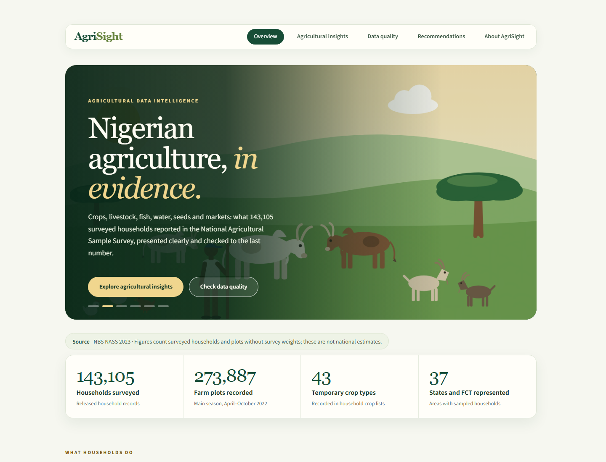

# AgriSight

### Agricultural Data Intelligence & Decision Support

AgriSight turns agricultural survey results into interactive findings about farming
activities, crops, inputs and marketing. It helps stakeholders explore what was
reported, understand the counting context and identify questions worth investigating.

**[Explore the live demo](https://agrisight-demo.streamlit.app/)** | [Repository](https://github.com/Engr-Daniel/agrisight) | [Hosting review](docs/PUBLIC_HOSTING_REVIEW.md)



*Overview captured from the public-mode application using its published aggregate bundle.*

## Explore the findings

- **Overview:** key figures, agricultural illustrations and routes into the evidence.
- **Agricultural Insights:** activities, crop portfolios, seed sources, irrigation,
  land arrangements, travel, harvest difficulties, sales, storage and input records.
- **Data Quality:** crop coverage, missing quantities and measurement limitations.
- **Recommendations:** evidence-supported questions for stakeholder follow-up.
- **About:** purpose, analytical scope and source citation.

Select a subject, switch between supported comparisons and inspect chart values.
Exact tables and expandable context explain denominators, eligibility and periods.
Explore which crops appear in the sample, where seed comes from, how sales and
retained storage overlap, and which input quantities are missing.

## Data and interpretation

The website presents AgriSight's analysis of historical **Nigeria National
Agricultural Sample Survey (NASS) 2023** results. It is **not an official NBS
publication**. Source:

> National Bureau of Statistics (NBS), Nigeria. *Nigeria - National Agricultural
> Sample Survey 2023 (NGA-NBS-NASS-2023-V01).* [NBS Microdata Catalogue](https://microdata.nigerianstat.gov.ng/index.php/catalog/173).

These are **unweighted sample findings, not national population estimates**.
Households, plots, crop records and input records are different counting units.
Crop results generally refer to April-October 2022; annual activity questions use
2022/2023. The map shows sample coverage, not agricultural prevalence or farm locations.

## Public release scope

The hosted entry point reads only a reviewed **display aggregate bundle** in
`public/`. It does not need or redistribute survey microdata, respondent IDs,
household coordinates, private intermediate files or synthetic research outputs.
Public administrative boundary geometry is separately attributed.

Public-results hosting is owner-authorized. The review records permission evidence,
disclosure decisions, dependency notices and remaining owner follow-up; it is not
a blanket legal certification. See the [hosting review](docs/PUBLIC_HOSTING_REVIEW.md)
and [third-party notices](THIRD_PARTY_NOTICES.md).

## Run locally

Requires Python 3.11+. Create and activate a virtual environment from the checkout
(`.venv\Scripts\Activate.ps1` on Windows; `source .venv/bin/activate` on Linux/macOS):

```sh
python -m venv .venv
# Activate the environment, then:
python -m pip install -r requirements/m4.lock
python -m pip install --no-build-isolation --no-deps .
python -m streamlit run public_app.py
```

Public mode works with the committed display bundle; no microdata download is
required. Open the local URL printed by Streamlit.

For authorized analysis with separately reproduced private evidence, use
`streamlit_app.py`. The technical explorer is `research_explorer_app.py`.
See [development instructions](docs/DEVELOPMENT.md) and the
[project charter](docs/PROJECT_CHARTER.md) for research and learning context.

## Repository guide

| Path | Purpose |
|---|---|
| `public_app.py` | Hosted public-results entry point |
| `public/` | Reviewed display-only evidence bundle |
| `src/agrisight/` | Python models, SQL, validation and interface |
| `tests/` | Analytical, privacy, failure-state and UI checks |
| `reports/` | Documented findings |
| `docs/` | Contracts, decisions, reproduction and release reviews |
| `TASK.md` / `MEMORY.md` | Actionable state and confirmed decisions |

Python, Streamlit, Pandas, Altair and SQLite power the application; Pytest, Ruff and
GitHub Actions support verification. To check a development checkout:

```sh
python -m pytest -q
python -m ruff check src tests scripts public_app.py streamlit_app.py research_explorer_app.py
```

## Status and next steps

The public demo is deployed; the current aggregate-only hosting review is complete
within its documented scope. Follow-up includes the archive publication-copy
obligation, screen-reader testing and future product refinement. Unsupported
variety, quantity and population-inference extensions remain gated; see [TASK.md](TASK.md).

## Author and licence

**Oyewale Daniel** | [GitHub](https://github.com/Engr-Daniel)

Application code is [MIT licensed](LICENSE). NBS source conditions, published-result
attribution, dependency licences and CC BY 4.0 boundary terms remain separate;
MIT does not grant redistribution rights over survey microdata. See the
[dependency review](docs/DEPENDENCY_LICENSE_REVIEW.md).
